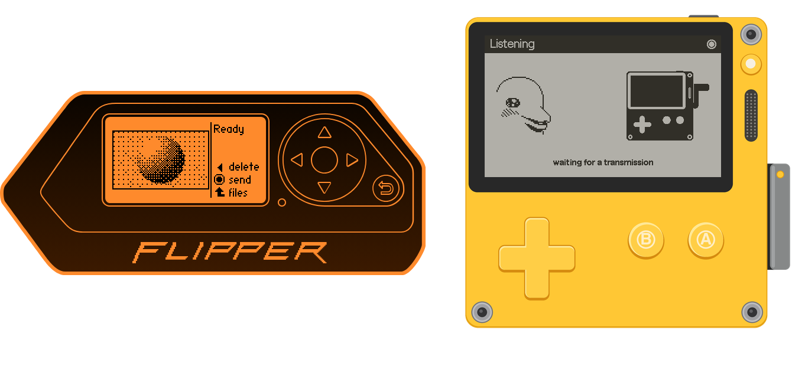

# SFTV RX: Slow Flipper TV for Playdate

SFTV RX receives pictures, notes and animations that the transmitter
([SFTV TX](https://github.com/Negenii/sftv-flipper) on a Flipper Zero) sends as near-ultrasound
(17–21 kHz). RX needs microphone access to work.

## Installing

Download `SFTV_RX.pdx` (or build it, see below) and put it on the Playdate one of two ways.

Over the air: upload the `.pdx`, or a zip of it, at
[play.date/account/sideload](https://play.date/account/sideload/). It shows up in the
Playdate's Game Library (Settings → Games on older system versions); refresh the list and
download it.

Over USB: connect the Playdate and choose Settings → System → Reboot to Data Disk. Copy the
`SFTV_RX.pdx` folder into `Games` on the PLAYDATE disk (the folder itself, not a zip), then
eject the disk.

To update, install the new version the same way. What you've received stays: it lives apart
from the app, in `Data/com.negenii.sftvrx/`.

## Getting started

1. Start listening in RX and allow the microphone.
2. On the transmitter ([SFTV TX](https://github.com/Negenii/sftv-flipper) on a Flipper Zero),
   pick a picture, an animation or a note and send it.
3. Keep the transmitter close to the receiver, 3–10 cm.

The picture appears line by line while the transmitter plays it. It comes in slowly: that's
why it's a slow TV. Whatever arrives is saved to the Gallery.

## Gallery

The newest item comes first; *filter* in the system menu narrows the list to images,
animations or notes. Animations play on their own, and the crank takes over when you turn it:
one turn a second is 30 fps, forwards or backwards.

Each picture is also saved as a PNG and each animation as a GIF in `Data/com.negenii.sftvrx/`,
so you can copy them to a computer with the Playdate in disk mode.

## Building

Needs the [Playdate SDK](https://play.date/dev/) (C API):

    tools/playdate_build.sh            # build SFTV_RX.pdx, bumping playdate/build_number
    tools/playdate_build.sh install    # also copy it to a Playdate on USB and start it

Plain `cd playdate && make` works too. Host tests of the shared protocol code:
`cd tests && make test`.

Layout: `playdate/` the app, `common/` the protocol in portable C (shared with SFTV TX),
`tests/` host tests and WAV tools, `tools/` asset generators (launcher art, fonts, QR codes),
`docs/` design notes.

## Protocol

8-FSK, 17.0–20.5 kHz, 3 ms symbols, synced by a tone pattern. 45-byte frames with
Reed-Solomon parity, interleaved in blocks of four, plus an outer Reed-Solomon code across
groups of 108 frames, so a lost frame comes back without a resend. The details are in `docs/`
and `common/sstv_params.h`.

## Credits and licenses

© 2026 negenii. The code is released under the GNU General Public License v3.0 (see
`LICENSE`). Some assets carry their own terms:

- Dolphin art (the receive scene, the launcher card and launch animation) comes from the
  Flipper Zero firmware, GPL-3.0.
- The Roobert fonts ship with the Playdate SDK by Panic and are not part of this repository:
  the build copies them from the installed SDK into the app, as the SDK's terms allow.
- The notes font (`Notes-14`) is generated from HaxrCorp 4089 by sahwar
  (`tools/haxrcorp4089.ttf`), CC BY-SA 3.0; the generated font is under the same license.
- The Buy Me a Coffee button is their brand asset, used to link to the support page.
- `docs/sftv.png` is a recording of one transmission, sped up: SFTV TX sending on the left,
  SFTV RX receiving on the right. The Flipper body is qFlipper's device art (GPL-3.0); the
  Playdate is drawn for this project from simple shapes.

If you like it, you can buy me a coffee:

